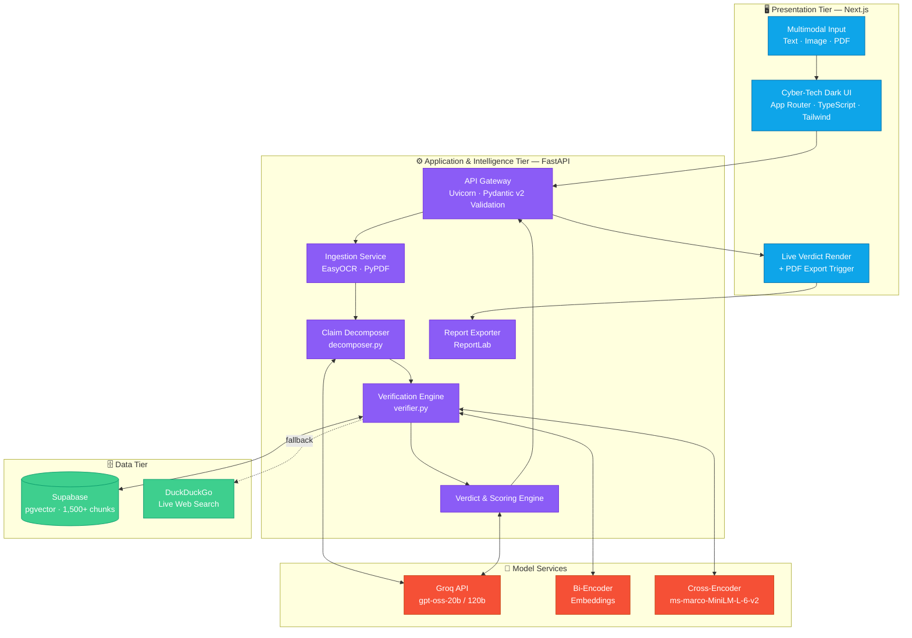
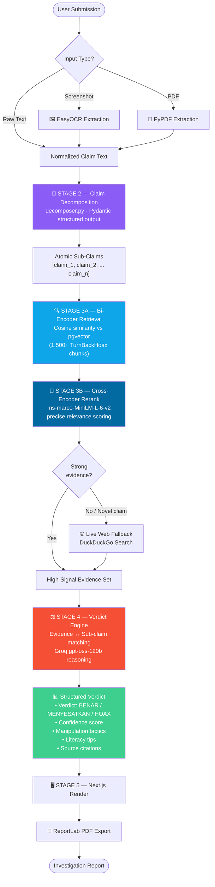
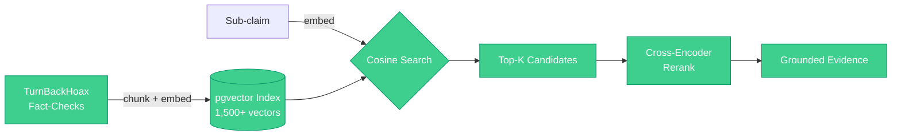

<div align="center">

# 🛡️ VeriClaim AI

### Enterprise Multi-Source RAG Fact-Checker & Media Literacy Platform

**Real-time detection and verification of hoaxes and misleading news in Indonesian, powered by Advanced RAG, Claim Decomposition, Two-Stage Reranking, and Multimodal Ingestion.**

<br/>

<!-- Core -->


<!-- AI / Inference -->


<!-- Data -->


<!-- Frontend -->


</div>

---

## 📖 Table of Contents

1. [Overview](#-overview)
2. [Key Capabilities](#-key-capabilities)
3. [Technology Stack](#-technology-stack)
4. [System Architecture](#-system-architecture)
5. [End-to-End Pipeline](#-end-to-end-pipeline)
6. [Component Breakdown](#-component-breakdown)
7. [The Verdict Engine](#-the-verdict-engine)
8. [Data & Knowledge Base](#-data--knowledge-base)
9. [Project Structure](#-project-structure)
10. [Design Rationale](#-design-rationale)

---

## 🎯 Overview

**VeriClaim AI** is a production-grade, multi-source Retrieval-Augmented Generation (RAG) platform engineered to combat the spread of hoaxes and misinformation in the Indonesian-language information ecosystem. Rather than returning a naive "true/false" label, the system performs **forensic-grade verification**: it decomposes complex claims into atomic, independently-checkable statements, retrieves evidence from a curated fact-checking corpus *and* the live web, and synthesizes a structured verdict enriched with confidence scoring, manipulation-tactic analysis, and media-literacy guidance.

The platform is designed for a dual audience:

- **End users** who need to rapidly verify a suspicious WhatsApp forward, screenshot, or news article.
- **Researchers & educators** who require transparent, citable, exportable investigation reports for media-literacy work.

> **Design philosophy:** Precision over recall. Every verdict is grounded in retrieved, reranked, and citable evidence — never in unverified model recall.

---

## ✨ Key Capabilities

| Capability | Description |
|------------|-------------|
| 🧩 **Claim Decomposition** | Compound, multi-part sentences are broken into standalone atomic sub-claims so each assertion is verified independently. |
| 🔍 **Two-Stage Retrieval** | Fast bi-encoder vector recall is refined by a precision cross-encoder reranker for high-signal context. |
| 🌐 **Multi-Source Evidence** | Blends a curated 1,500+ chunk fact-check knowledge base with real-time live web search fallback. |
| 🖼️ **Multimodal Ingestion** | Accepts raw text, chat/news **screenshots** (OCR), and **PDF** press releases or government circulars. |
| 🧠 **Manipulation Analysis** | Surfaces the psychological persuasion tactics a piece of misinformation uses. |
| 📊 **Structured Verdicts** | Deterministic, schema-validated output (Pydantic v2) — never free-form prose. |
| 📄 **PDF Report Export** | One-click generation of a formal "Investigation Report" for archival or sharing. |
| 🎓 **Media-Literacy Tips** | Each verdict includes actionable digital-literacy guidance tailored to the claim. |

---

## 🛠️ Technology Stack

### Backend & API Layer
| Technology | Role |
|------------|------|
| **Python** | Primary backend language |
| **FastAPI + Uvicorn** | Async API framework and ASGI server |
| **Pydantic v2** | Structured output contracts & request/response validation |

### AI & NLP Framework
| Technology | Role |
|------------|------|
| **LangChain** | Orchestration of the RAG pipeline and LLM interactions |
| **Groq API** | Ultra-low-latency LLM inference — `openai/gpt-oss-20b` (fast path) & `openai/gpt-oss-120b` (deep reasoning) |
| **HuggingFace Transformers** | Model loading & local inference runtime |
| **Sentence-Transformers** | Bi-Encoder embeddings (retrieval) + Cross-Encoder (reranking) |

### Data & Knowledge Base
| Technology | Role |
|------------|------|
| **Supabase (PostgreSQL)** | Managed Postgres datastore |
| **pgvector** | Vector similarity search via cosine distance |
| **TurnBackHoax Corpus** | 1,500+ pre-ingested, pre-verified fact-check chunks |
| **DuckDuckGo Search** | Live web-search fallback for novel/breaking claims |

### Frontend
| Technology | Role |
|------------|------|
| **Next.js (App Router)** | React framework & routing |
| **TypeScript** | End-to-end type safety |
| **Tailwind CSS** | Utility-first styling (Cyber-Tech Dark Theme) |
| **Lucide React** | Iconography |

### Document Processing
| Technology | Role |
|------------|------|
| **EasyOCR** | Local OCR for images/screenshots |
| **PyPDF** | Text extraction from PDF documents |
| **ReportLab** | Programmatic PDF Investigation Report generation |

---

## 🏛️ System Architecture

VeriClaim AI follows a **decoupled three-tier architecture** — a presentation tier (Next.js), an application/intelligence tier (FastAPI + RAG pipeline), and a data tier (Supabase/pgvector + live web). The intelligence tier is itself internally layered into *ingestion*, *decomposition*, *retrieval*, and *reasoning* stages, each independently testable and replaceable.



---

## 🔄 End-to-End Pipeline

The core of VeriClaim AI is a **5-stage verification pipeline**. A single user submission flows through multimodal normalization, atomic decomposition, two-stage retrieval, evidence-grounded reasoning, and structured reporting.



### Stage Details

**Stage 1 — Multimodal Ingestion**
All inputs are normalized to a canonical text representation at the edge of the pipeline. Text passes through directly; images are processed by **EasyOCR** running locally (no third-party image upload); PDFs are parsed by **PyPDF**. This stage guarantees every downstream component operates on a single, consistent `str` contract regardless of source modality.

**Stage 2 — Claim Decomposition** (`app/decomposer.py`)
A compound statement such as *"Vaccine X causes infertility and the government is hiding the data"* carries two independent truth claims. The decomposer prompts the Groq LLM under a **strict Pydantic v2 schema**, returning a validated list of atomic sub-claims. Verifying each sub-claim independently prevents a single true (or false) component from contaminating the verdict of the whole.

**Stage 3 — Two-Stage Multi-Source Retrieval** (`app/verifier.py`)
A classic **recall-then-precision** retrieval cascade:
- *Stage 3A — Bi-Encoder Retrieval:* Each sub-claim is embedded and matched against the pgvector index via **cosine distance**, cheaply surfacing a broad candidate set from the 1,500+ chunk corpus.
- *Stage 3B — Cross-Encoder Reranking:* The candidates are jointly re-scored by a local **`ms-marco-MiniLM-L-6-v2`** cross-encoder, which reads each (sub-claim, candidate) pair together to produce a far more accurate relevance ranking than embedding similarity alone.
- *Fallback:* When corpus evidence is weak or the claim is novel/breaking, the engine escalates to **DuckDuckGo** live web search so coverage is never silently blind.

**Stage 4 — Evidence Scoring & Verdict Engine**
Reranked, multi-source evidence is aligned against each sub-claim. The engine (backed by Groq `gpt-oss-120b` for deep reasoning) emits a structured verdict — one of **BENAR**, **MENYESATKAN**, or **HOAX** — plus a confidence score, the manipulation tactics detected, tailored digital-literacy tips, and the exact source citations behind the judgment.

**Stage 5 — Reporting & Export**
The verdict streams into the Next.js UI for real-time rendering, and can be exported as a formal, archival **PDF Investigation Report** via **ReportLab**.

---

## 🧱 Component Breakdown

| Component | Module | Responsibility | Key Dependencies |
|-----------|--------|----------------|------------------|
| **API Gateway** | `app/main.py` | Request routing, validation, response contracts | FastAPI, Uvicorn, Pydantic |
| **Ingestion Service** | `app/ingestion.py` | Normalize text / image / PDF → canonical text | EasyOCR, PyPDF |
| **Claim Decomposer** | `app/decomposer.py` | Compound claim → atomic sub-claims | LangChain, Groq, Pydantic |
| **Verification Engine** | `app/verifier.py` | Two-stage retrieval + web fallback | Sentence-Transformers, pgvector, DuckDuckGo |
| **Verdict Engine** | `app/verdict.py` | Evidence↔claim matching, scoring, tactic analysis | Groq `gpt-oss-120b` |
| **Report Exporter** | `app/report.py` | Render Investigation Report PDF | ReportLab |
| **Frontend App** | `web/` | Multimodal input, live render, export trigger | Next.js, TypeScript, Tailwind |

> Module paths above reflect a representative layout; adapt to match your actual repository file names.

---

## ⚖️ The Verdict Engine

VeriClaim AI deliberately avoids binary classification. Indonesian misinformation frequently mixes verifiable fact with misleading framing, so the system resolves to a **three-way verdict**:

| Verdict | Meaning | Typical Signal |
|---------|---------|----------------|
| 🟢 **BENAR** | Claim is substantiated by credible evidence | Sub-claims corroborated by fact-check corpus and/or reputable live sources |
| 🟡 **MENYESATKAN** | Misleading — contains truth but framed to deceive | Partially-true sub-claims combined with missing context or manipulative framing |
| 🔴 **HOAX** | Fabricated or debunked | Sub-claims directly contradicted by TurnBackHoax entries or authoritative sources |

Alongside the verdict, every response carries:

- **Confidence score** — calibrated to evidence strength and cross-encoder relevance.
- **Psychological manipulation tactics** — e.g. fear appeal, false authority, out-of-context imagery.
- **Digital-literacy tips** — concrete, claim-specific guidance to help users self-verify next time.
- **Source citations** — the precise evidence (corpus chunk or web result) each judgment rests on.

---

## 🗄️ Data & Knowledge Base

- **Primary corpus:** 1,500+ chunks pre-ingested from **TurnBackHoax**, Indonesia's leading community fact-checking initiative — already debunked, dated, and attributed.
- **Vector store:** Supabase Postgres with the **pgvector** extension; retrieval uses **cosine distance** over bi-encoder embeddings.
- **Freshness strategy:** The static corpus anchors precision for known hoaxes; **DuckDuckGo** live search extends coverage to breaking events the corpus cannot yet contain — a deliberate *precision-anchored, recall-extended* design.



---

## 📁 Project Structure

```
vericlaim-ai/
├── app/                      # FastAPI backend
│   ├── main.py               # API gateway & routes
│   ├── ingestion.py          # EasyOCR + PyPDF multimodal normalization
│   ├── decomposer.py         # Claim → atomic sub-claims (Pydantic structured output)
│   ├── verifier.py           # Two-stage retrieval + DuckDuckGo fallback
│   ├── verdict.py            # Evidence scoring & verdict engine
│   ├── report.py             # ReportLab PDF Investigation Report
│   ├── models.py             # Pydantic v2 schemas
│   └── config.py             # Settings & secrets management
├── web/                      # Next.js frontend
│   ├── app/                  # App Router pages
│   ├── components/           # UI components (Cyber-Tech Dark Theme)
│   └── lib/                  # API client & types
├── data/                     # Corpus ingestion scripts
├── requirements.txt
└── README.md
```

> Representative layout — align with your actual tree.

---

## 🧠 Design Rationale

| Decision | Why |
|----------|-----|
| **Claim decomposition before retrieval** | Atomic claims retrieve cleaner evidence and prevent compound statements from collapsing into a single misleading verdict. |
| **Bi-encoder → cross-encoder cascade** | Bi-encoders are fast but imprecise; cross-encoders are precise but costly. The cascade gets the best of both — cheap recall, expensive precision only where it matters. |
| **Pydantic v2 structured output** | Guarantees machine-parseable, schema-valid verdicts — essential for a reliable frontend contract and deterministic PDF export. |
| **Corpus + live-web hybrid** | A static corpus alone goes stale; live search alone is noisy and un-curated. Hybrid retrieval anchors precision while extending coverage. |
| **Local OCR (EasyOCR)** | Keeps user screenshots on-infrastructure rather than shipping images to a third-party vision API — a privacy and cost win. |
| **Groq dual-model (20B/120B)** | Lightweight 20B for fast decomposition; 120B reserved for evidence-grounded final reasoning — balancing latency and depth. |

---

<div align="center">

**VeriClaim AI** — *Verify before you share.*

Built with precision-first RAG for a more resilient information ecosystem. 🇮🇩

</div>
